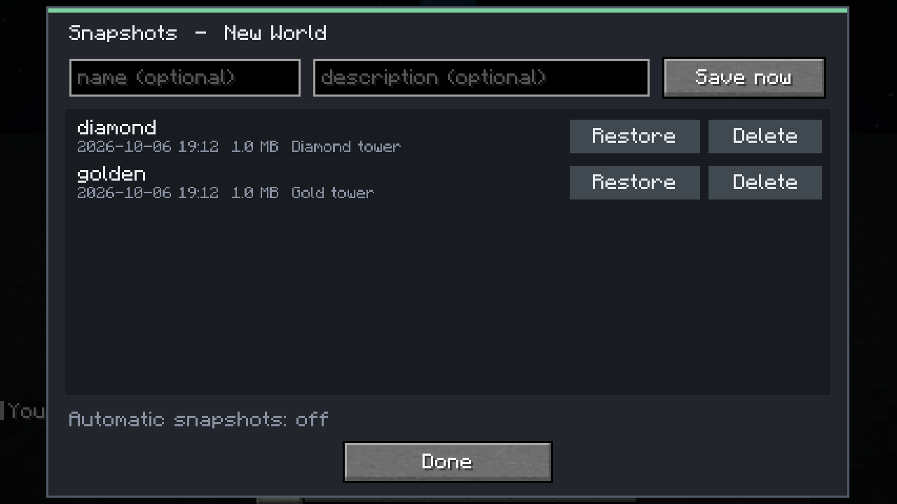
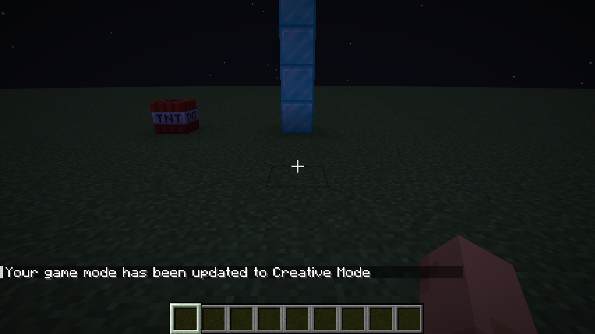
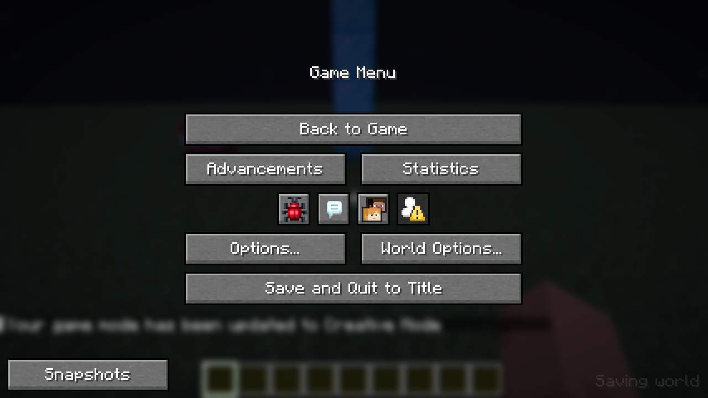
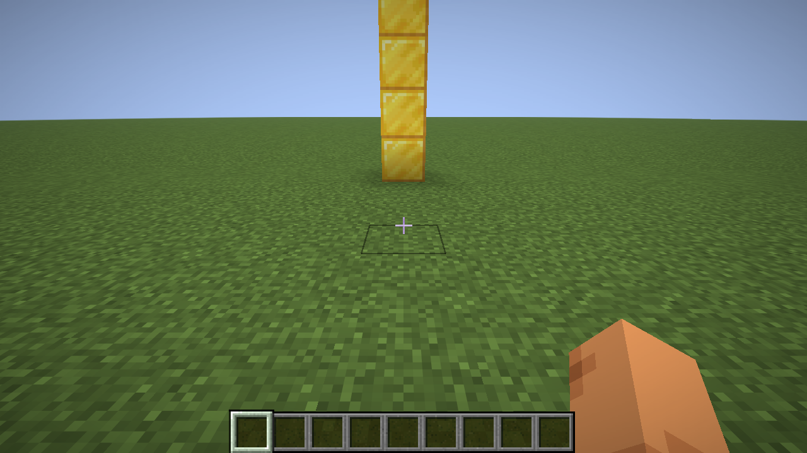

# Rewind

World snapshots for **Minecraft 26.3** (Fabric). Save the whole world under a name, and go back to it,
or to any other snapshot, whenever you like. Works in singleplayer, on LAN and on dedicated servers.

Online handbook: https://mchamradio.antwire.net/handbook/rewind/
Source code: [github.com/Lamisator/mc_rewind](https://github.com/Lamisator/mc_rewind)



## What a snapshot holds

Everything in the world folder: terrain, buildings, chests, entities, time and weather, every player's
inventory and position, and the data other mods keep with the world (Gridworks' grid, Radiation's
sources and emitters, Ham Radio's callsigns and logbooks, Fission's reactors). Going back to a snapshot
puts all of that back exactly as it was.

**Every map, always.** A snapshot holds every map (dimension) of the world: the overworld, the Nether,
the End, and every world a multiverse mod such as [Worlds](https://modrinth.com/mod/mc-worlds) adds, including
ones created after Rewind was installed. They all live in the world folder (`dimensions/<namespace>/<name>/`), and
Rewind copies the whole folder, so a new map needs no setup. Saving pauses for every map while the files are
copied, also for a map that is created or woken up during the copy. `/snapshot info <name>` lists the maps a
snapshot holds, and the chat says how many when it is saved. Restoring brings back all maps together, as they were.

Mod jars and configuration files are not part of a world, so they are not in snapshots either.

## Installing

1. In Prism Launcher, make a Minecraft **26.3** instance with **Fabric** (loader 0.19.5 or newer), and
   install **Fabric API**.
2. **Add file**: `rewind-1.1.0.jar`.

On a server, put the jar into the server's `mods` folder. Players only need it on their side for the
pause-menu screen; the `/snapshot` command works without it.

## Taking a snapshot

- **Pause menu → Snapshots** (bottom left): type a name and a description (both optional) and press
  **Save now**.
- Or the command: `/snapshot save [name] [description]`. Without a name it is called
  `snapshot-<date>-<time>`.

The world is saved first. Then autosave pauses while the files are copied in the background, so the
copy is consistent and the game keeps running. Snapshots are **incremental**: every file that has not
changed since the previous snapshot is hard-linked rather than copied. Ten snapshots of a big world cost
little more than one plus what changed in between.

Snapshot names may contain letters, digits and `_ . + -`, up to 48 characters.

## Going back

- **Snapshots** screen: **Restore**, then **Sure?** within four seconds.
- Or `/snapshot restore <name>`, then click **[Confirm]** (or type `/snapshot restore <name> confirm`).

A world cannot be swapped while it is running, so a restore always closes it for a moment:

- **Singleplayer / LAN host**: the game saves, leaves the world, puts the snapshot in place and reopens
  the world on its own. LAN guests are disconnected and can rejoin.
- **Dedicated server**: everyone gets a message, then after five seconds they are disconnected. The
  server stops, puts the snapshot in place and exits with code **75**. A supervisor that restarts on
  failure (systemd `Restart=on-failure`, most hosting panels) starts it again with the restored world.
  With `restartExitCode` set to 0 it just stops. If it is killed before it can restore, it finishes the
  restore at the next start, before the world loads.

**Every restore can be undone.** Before the snapshot goes in, the current world is set aside as a
snapshot called `before-restore-<date>-<time>` (a rename, so it costs no time). Restore that one to get
back to where you were. The last five are kept.

| Before | Snapshot screen | After the restore |
|---|---|---|
|  |  |  |

## Commands

All need operator rights (permission level 2) or being the singleplayer host.

| Command | |
|---|---|
| `/snapshot save [name] [description]` | Take a snapshot |
| `/snapshot list` | All snapshots of this world with date, size and a click-to-restore link |
| `/snapshot info <name>` | Details: who took it, game day, files, size, mods at the time |
| `/snapshot restore <name> [confirm]` | Go back to a snapshot |
| `/snapshot delete <name> [confirm]` | Delete a snapshot |
| `/snapshot auto <minutes> [keep]` | Automatic snapshots every so many minutes, keeping the last `keep` |
| `/snapshot auto off` | No automatic snapshots |

Names complete with Tab. In the list, manual snapshots are white, automatic ones green and
before-restore ones yellow.

## Where they are

`<game directory>/snapshots/<world folder>/<snapshot>/`. In singleplayer that is next to `saves/`; on a
server, next to the world folder. Each snapshot is a complete, ordinary world folder plus
`snapshot.json` and `manifest.json`. To start a new world from a snapshot, copy its folder into
`saves/` (singleplayer) or point `level-name` at it (server).

Snapshots stay when a world is restored, and they belong to the world folder's name.

## Configuration

`config/rewind.json` (on a server, the server's copy):

| Setting | Default | |
|---|---|---|
| `snapshotDir` | `snapshots` | Folder for snapshots, relative to the game or server directory |
| `autoIntervalMinutes` | 0 | Minutes between automatic snapshots; 0 = off |
| `autoKeep` | 12 | Automatic snapshots to keep |
| `keepBeforeRestore` | 5 | Before-restore snapshots to keep |
| `restartExitCode` | 75 | Exit code of a dedicated server after a restore; 0 = plain stop |
| `restoreWarningSeconds` | 5 | Seconds between the restore message and the disconnect on a server |

## Building from source

```
./gradlew build             # build/libs/rewind-1.1.0.jar
./gradlew runClientGameTest # takes, changes, restores and un-restores a test world
```

## License

MIT
